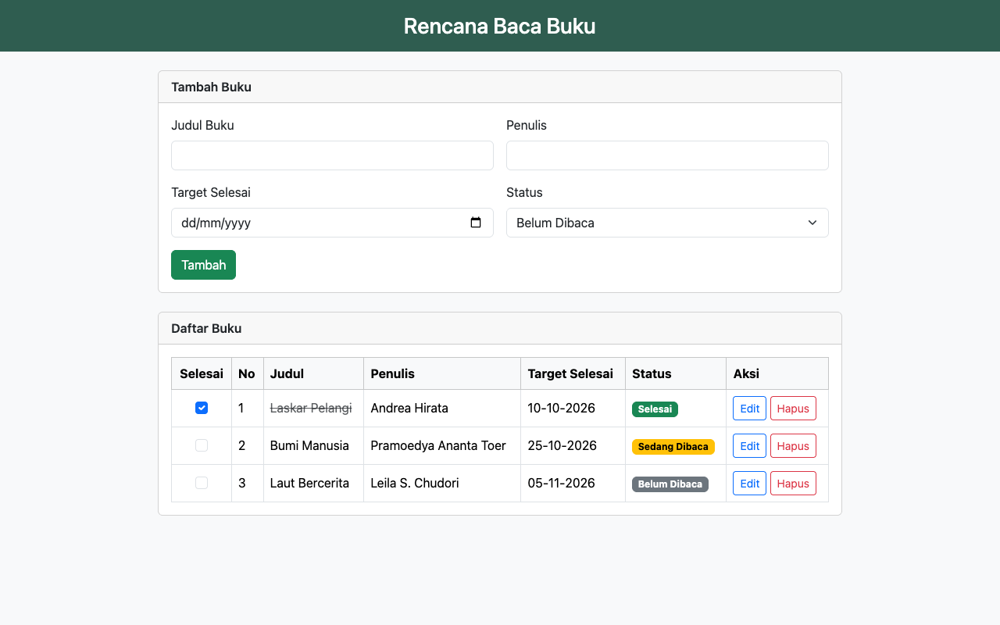

# To-Do List Rencana Baca Buku

Aplikasi web sederhana untuk mencatat buku yang ingin dibaca beserta target tanggal selesainya.
Data buku bisa ditambah, diubah, ditandai selesai, dan dihapus. Aplikasi ini dibuat sebagai
tugas praktik uji kompetensi BNSP.



## Fitur

- Tambah buku: judul, penulis, target selesai, dan status
- Daftar buku dalam bentuk tabel
- Edit data buku
- Checkbox untuk menandai buku sudah selesai dibaca
- Hapus buku, dengan konfirmasi sebelum data dihapus
- Validasi input dan notifikasi setelah setiap aksi

Status buku terdiri dari *Belum Dibaca*, *Sedang Dibaca*, dan *Selesai*.

## Teknologi

- PHP 8 (native) dengan PDO
- SQLite 3, berupa file sehingga tidak perlu server database
- Bootstrap 5.3.3, disimpan lokal di `assets/css` sehingga tidak butuh koneksi internet

## Instalasi dan Menjalankan

Kebutuhan: PHP 8.1 atau lebih baru dengan ekstensi `pdo_sqlite` aktif.

```bash
git clone https://github.com/Turatech-Wyl/LSP_todolist.git todolist
php -S 0.0.0.0:80
```

Perintah `php -S` dijalankan dari folder yang berisi folder `todolist`. Setelah itu buka
`http://localhost/todolist/` di browser.

Kalau port 80 tidak bisa dipakai, masuk ke folder `todolist`, jalankan `php -S localhost:8000`,
lalu buka `http://localhost:8000`.

Database (`database/rencana_baca.sqlite`) dan tabelnya otomatis dibuat saat aplikasi pertama kali dibuka.
Halaman `cek_lingkungan.php` bisa dipakai untuk memastikan PHP, ekstensi SQLite, dan koneksi database sudah berjalan.

## Cara Penggunaan

1. **Menambah buku**: isi form *Tambah Buku*, lalu klik **Tambah**.
2. **Menandai selesai**: centang checkbox di kolom *Selesai*. Kalau centangnya dihilangkan, status kembali ke *Belum Dibaca*.
3. **Mengedit buku**: klik **Edit** pada baris buku. Form di atas akan terisi data buku tersebut.
   Ubah datanya lalu klik **Simpan Perubahan**, atau klik **Batal** untuk membatalkan.
4. **Menghapus buku**: klik **Hapus**, lalu pilih **OK** di dialog konfirmasi.

## Struktur Folder

```
todolist/
├── index.php              halaman utama (form dan daftar buku)
├── proses.php             menangani aksi tambah, ubah, status, dan hapus
├── functions.php          fungsi helper, validasi, dan query database
├── cek_lingkungan.php     cek versi PHP, ekstensi SQLite, dan koneksi database
├── config/
│   └── database.php       koneksi PDO ke SQLite
├── database/
│   └── schema.sql         struktur tabel buku
├── assets/
│   ├── css/
│   │   ├── bootstrap.min.css
│   │   └── style.css
│   └── favicon.svg
└── docs/
    └── tampilan.png
```

## Struktur Kode

**Alur aplikasi.** `index.php` hanya menampilkan data. Setiap form mengirim data ke `proses.php`
lewat POST. Di sana data divalidasi lalu disimpan ke database, kemudian pengguna diarahkan kembali
ke `index.php`. Pesan notifikasi disimpan sementara di session, sehingga tidak muncul lagi
saat halaman di-refresh. Kalau validasi gagal, isian form tetap ada.

**Tabel `buku`:**

| Kolom | Keterangan |
|---|---|
| `id` | primary key, auto increment |
| `judul` | wajib diisi, maksimal 100 karakter |
| `penulis` | wajib diisi, maksimal 100 karakter |
| `target_selesai` | tanggal dengan format `YYYY-MM-DD` |
| `status` | `Belum Dibaca`, `Sedang Dibaca`, atau `Selesai` |
| `dibuat_pada`, `diubah_pada` | waktu data dibuat dan terakhir diubah |

**Fungsi di `functions.php`:**

- Helper: `e()`, `formatTanggal()`, `redirect()`, `kembali()`, `ambilFlash()`, `ambilPesan()`, `warnaStatus()`, `inputAksi()`
- Validasi: `ambilInputBuku()`, `tanggalValid()`, `validasiBuku()`
- Database: `ambilSemuaBuku()`, `ambilBuku()`, `tambahBuku()`, `ubahBuku()`, `ubahStatus()`, `hapusBuku()`

Semua query memakai prepared statement, dan semua output ke HTML di-escape dengan fungsi `e()`.

## Pemeliharaan

- **Backup data**: salin file `database/rencana_baca.sqlite`.
- **Reset data**: hapus file tersebut. Database kosong akan dibuat ulang saat aplikasi dibuka.
- **Menambah status**: ubah `DAFTAR_STATUS` di `functions.php` dan aturan `CHECK` di `database/schema.sql`,
  lalu tentukan warnanya di `warnaStatus()`.
- **Menambah kolom**: ubah `schema.sql`, `ambilInputBuku()`, `validasiBuku()`, `tambahBuku()`,
  dan `ubahBuku()`, lalu tambahkan input serta kolom tabelnya di `index.php`.
- **Setelah mengubah kode**: jalankan `php -l <nama file>`, lalu coba lagi fitur tambah, edit,
  checkbox, dan hapus di browser sambil memantau console di DevTools.

## Pembuat

Willie Putra Angkasa
